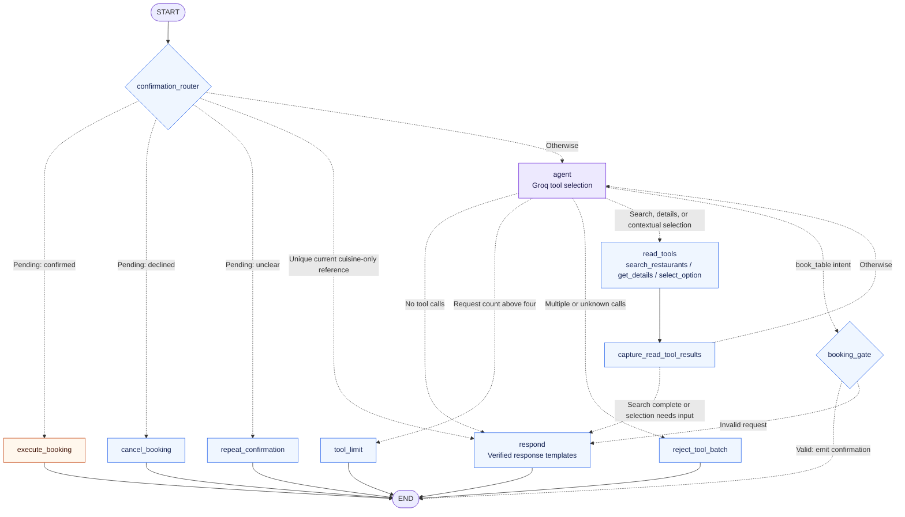

# Restaurant Booking Agent Architecture

This document describes the current implementation in [graph.py](../src/restaurant_booking/graph.py).

[README](../README.md) · [Development](development.md) · [Troubleshooting](troubleshooting.md)

## Goals and constraints

- Build a Python command-line assistant for restaurant search, availability lookup, and booking across multiple conversation turns.
- Keep application code, prompts, and documentation in English.
- Use the supplied `tools.py` and `restaurants.json` without modifying them. Adapters validate and sanitize their outputs.
- Use Groq through LangChain for language understanding, contextual references, and tool selection. Keep validation, confirmation, and booking side effects under application control.
- Treat tool results as the only source of restaurant names, prices, and available times.

## Runtime choices

Direct dependencies are pinned in [pyproject.toml](../pyproject.toml); [uv.lock](../uv.lock) records the resolved environment. The table reflects those pins, not a claim about the latest upstream releases.

| Package | Version | Purpose |
| --- | --- | --- |
| `langchain` | `1.4.2` | Langfuse callback integration dependency |
| `langgraph` | `1.2.12` | Stateful graph orchestration |
| `langchain-core` | `1.6.5` | Messages, runnables, and tool interfaces |
| `langchain-groq` | `1.1.3` | Groq `ChatGroq` integration |
| `groq` | `0.37.1` | Provider SDK and typed rate-limit errors |
| `langfuse` | `4.15.4` | Optional model and graph observability |
| `python-dotenv` | `1.2.3` | Local environment configuration |

The default model is `openai/gpt-oss-120b`, configurable through `GROQ_MODEL`.

## Package layout

```text
src/restaurant_booking/
    __init__.py          # Package version
    __main__.py          # python -m entry point
    cli.py               # Interactive CLI and Langfuse lifecycle
    config.py            # Environment-backed settings
    state.py             # Typed graph state and booking candidate
    restaurant_tools.py  # Validated adapters around tools.py
    graph.py             # StateGraph, nodes, routing, and prompt
    responses.py         # Reference/time resolution and verified response templates
pyproject.toml           # Package metadata and pinned dependencies
uv.lock                  # Cross-platform resolved dependency lock
.python-version          # Python 3.12 selection for uv
README.md                # Setup and execution guide
docs/architecture.md     # This runtime design and graph diagram
docs/development.md      # Contribution workflow and local checks
docs/troubleshooting.md  # Setup and operational guidance
docs/assessment/         # Original and Spanish challenge documents
tests/                   # Offline unit and graph integration tests
.github/workflows/ci.yml # Windows/Linux checks for Python 3.12 and 3.13
```

The wrapper loads the supplied root-level `tools.py`. The original `tools.py` and `restaurants.json` are left unchanged.

## Runtime graph

This is the topology registered by `build_graph()`: **11 application nodes, START/END, and 22 edges, including 14 conditional routes**. Node identifiers match the code. Solid arrows are unconditional edges; dashed arrows are conditional routes.



`END` finishes one invocation, not the CLI conversation. The CLI prints the final nonempty assistant message and waits for another input. The next input starts at `START` with the same thread's state, except after recursion-limit recovery.

The confirmation question is emitted **inside `booking_gate`**. Availability refreshes and conflict responses also run inside existing nodes: there are no separate `confirmation`, `refresh`, or `alternatives` nodes. `reject_tool_batch` and `tool_limit` call the `render_response()` helper internally and go straight to `END`; they do not traverse the `respond` node.

### Route priorities

The checks in each group run in the order shown. A plain "yes" does not execute a booking unless a candidate is already pending.

| Router | Condition, in priority order | Destination |
| --- | --- | --- |
| `_route_confirmation` | Pending candidate and a later recognized affirmative | `execute_booking` |
| | Pending candidate and a later recognized negative | `cancel_booking` |
| | Pending candidate and an unrecognized confirmation reply | `repeat_confirmation` |
| | Unique current cuisine-only reference, known group, no pending booking or selected time | `respond` |
| | Otherwise | `agent` |
| `_route_agent` | Latest AI message has no tool calls | `respond` |
| | Cumulative emitted tool requests exceed four | `tool_limit` |
| | Current response contains multiple calls | `reject_tool_batch` |
| | Single `book_table` request | `booking_gate` |
| | Single `search_restaurants`, `get_details`, or `select_option` request | `read_tools` |
| | Unknown tool name | `reject_tool_batch` |
| `_route_read_results` | Search completed successfully, including an empty result | `respond` |
| | `select_option` leaves ambiguity, an error notice, or no selected time | `respond` |
| | Otherwise | `agent` |
| `_route_booking_gate` | Valid candidate; confirmation emitted | `END` |
| | Invalid request | `respond` |

A confirmation decision requires `pending_booking` and a user message ID different from the one that created that candidate. Without a pending candidate, the turn router performs preliminary matching for names, simple cuisine descriptions, positions, focus, and explicit times. It refreshes the selected restaurant, or the last displayed restaurants when none is selected, through the original `get_details` function. A strict cuisine-only match can then go directly to `respond`; other turns reach `agent`, including when preliminary matching is ambiguous, so the model can interpret negation, comparisons, and historical context before clarification is rendered.

Short cuisine descriptions such as `Vegetarian` or `the vegetarian one` bypass the model only when the group is known, the selection uniquely matches a currently displayed and previously offered restaurant, and no time or booking confirmation is pending. The normalized message must match the cuisine alone, optionally with an article and `one`, `option`, or `restaurant`. The router has already refreshed the selected record. Negations, compound preferences, historical descriptions, and other contextual references still reach the model. Preference changes can trigger a new search; a missing restaurant or time blocks booking, not search refinement.

If the model returns no tool calls, `agent` can recover a simple positive cuisine request when a group is stored, no booking is pending, and no tool action has occurred in the current turn. `resolve_cuisine_request()` obtains cuisine categories from the original search function and matches only a complete positive phrase, optionally using `I prefer`, `I want`, or `I would like`, an article, `food`/`cuisine`/`restaurant(s)`, and `please`. It does not maintain a hardcoded cuisine list. A match creates a `search_restaurants` request through the existing read-tools path, preserving the group and other filters. This happens inside `agent`, adds no graph node or edge, and makes no extra Groq call. Existing model actions, negative requests, combined constraints, and unsupported categories are not replaced by this fallback. The search tool description explicitly identifies `vegetarian` as a supported catalogue category.

### Booking across turns

These are representative paths. Groq may choose additional read tools, but the confirmation boundary is enforced by the graph.

The prompt treats an explicit answer to the time-selection question as a request to prepare the booking confirmation, without first asking whether to start booking. If the model returns without a booking request, the response template asks about booking intent; it never executes a reservation itself.

| Input or event | Path after `confirmation_router` | Result |
| --- | --- | --- |
| Group supplied; model requests search | `agent -> read_tools -> capture_read_tool_results -> respond -> END` | Present checked options and ask for one missing choice. |
| Unique current cuisine-only reference without a selected time | `respond -> END` | Present refreshed availability and ask for a time without calling Groq. |
| Contextual reference resolves to a unique option without a time | `agent -> read_tools -> capture_read_tool_results -> respond -> END` | Validate a `select_option` request, then show the selected option and ask for a time. |
| Contextual selection remains ambiguous or invalid | `agent -> read_tools -> capture_read_tool_results -> respond -> END` | Ask for clarification without another model attempt in that turn. |
| Contextual selection supplies a restaurant and a verified time | `agent -> read_tools -> capture_read_tool_results -> agent -> booking_gate -> END` | The model can request the booking readback after selection validation. |
| Preliminary reference remains ambiguous; model requests no tools | `agent -> respond -> END` | Ask which restaurant; no booking candidate is created. |
| Restaurant and time selected; model requests booking | `agent -> booking_gate -> END` | Read back restaurant, time, and group. No booking yet. |
| User confirms the pending candidate | `execute_booking -> END` | Execute the stored candidate once; report a reference or explain the failure. |
| User selects a new time after a conflict | `agent -> booking_gate -> END` | Create a new candidate and ask for confirmation again. |

A normal successful search and a model-interpreted contextual selection without a time each use one Groq request: the renderer does not need a second model pass. A completed contextual selection can return to the model to request the booking gate. A strict unique cuisine-only selection and confirmation of a pending candidate use no Groq request. These paths reduce calls without changing the four-tool-request limit or the requirement for a separate booking confirmation.

The original challenge function deliberately removes the requested slot and raises `ValueError` on the first otherwise valid booking attempt in the process. The application refreshes availability, explains the lost slot, and requires a new choice and confirmation. It does not switch times or retry automatically. Successful and failed attempts update current details and search records so later replies do not advertise a consumed slot.

When routing changes, compare this diagram's node IDs and edges with `build_graph(...).get_graph()` and the route functions. Helper calls belong in their owning node's description, not as extra graph nodes.

### Contextual selection

The full model profile has four bound tools: `search_restaurants`, `get_details`, `select_option`, and `book_table`. Before a party size is stored and while `offered_options` is empty, `agent` instead uses `INITIAL_PROMPT` with only `search_restaurants` bound. This compact profile still receives the conversation history, so a reply to the group-size question can trigger the first search. Once a group or offered option exists, model calls use the full prompt, verified state, and four tools.

The first three tools run in the existing `read_tools` node. `select_option` updates conversation state and refreshes availability; it does not search the catalogue or execute a booking. `book_table` remains an intent signal routed to the booking gate.

For turns that reach the model, Groq uses the last question, message history, `offered_options`, and the displayed shortlist to express a contextual selection. Direct matches remain preliminary outside the strict cuisine-only path: the model can correct them through `select_option`, for example when a user names one restaurant only to reject it. Merely mentioning a choice in model prose or calling `get_details` does not select it.

| Reference | Interpretation and validation |
| --- | --- |
| Cuisine, area, partial name, exclusion, or an earlier offer | The model submits matching previously displayed IDs. The adapter rejects unoffered IDs, refreshes the candidates, and requires a single remaining match. |
| Cheaper, more expensive, higher/lower rating, or earlier/later availability | The model submits all relevant candidates and a supported criterion. Python computes the comparison from refreshed records; ties and missing required data request clarification. |
| Explicit or colloquial time | The model can submit an exact returned slot; Python requires it to exist in refreshed availability. The deterministic parser also handles compact values such as `1945` as `19:45`, accepting them only when that exact slot is returned. |
| Earliest/latest time or a time ordinal | Earliest/latest is computed from the selected restaurant's returned slots. For an ordinal, the model uses the last question and displayed slot order to submit an exact slot. |
| No supported match or unresolved interpretation | An empty or nonunique candidate list produces a clarification notice. The graph routes that result to `respond`, ending the turn. |

Candidate interpretation still depends on the model: Python validates the submitted IDs, comparison facts, and time, but cannot prove that every relevant candidate was included or that the user meant a particular description. References are bounded by offered records; distance, ambience, and other absent attributes cannot be established from this data. The code does not guarantee correct interpretation of every language or paraphrase. A validated selection still requires the normal booking readback and a separate confirmation.

## State model

`BookingState` uses LangGraph's `add_messages` reducer and keeps verified restaurant and booking facts separate from model output:

- `messages`: the conversation history for the active thread.
- `party_size`: the validated group size from the latest successful search, reused when later searches omit it.
- `search_filters`: effective cuisine, area, maximum price, and rating threshold, retained across refinements.
- `search_results`: up to three available restaurants with verified details, ordered by descending rating.
- `offered_restaurant_ids`: IDs returned by that latest search; despite the name, these do not establish that an option was displayed.
- `details_by_id`: verified details for current results and selected restaurants, updated by availability refreshes.
- `offered_options`: records actually shown to the user, retained across searches to identify earlier offers.
- `displayed_restaurant_ids`: the last displayed choices, used to resolve numbered or ordinal references.
- `selected_restaurant_id` and `selected_time`: preliminary direct matches or choices validated through `select_option`; a time must match refreshed availability.
- `reference_ambiguous`, `search_completed_this_turn`, and `response_error`: signals for deterministic clarification and rendering.
- `pending_booking`: exact restaurant ID, name, time, party size, and originating user message ID awaiting confirmation.
- `booking_status` and `booking_reference`: booking lifecycle, with a reference set only after a successful tool return.
- `confirmation_decision` and `booking_gate_result`: internal routing signals.
- `tool_calls_this_turn`: number of tool requests, including the narrow cuisine fallback, reset for each user turn and bounded to prevent tool loops.

A successful search replaces current results and clears the selection and pending booking. It does not erase `offered_options`: historical offers establish identity, while fresh calls to the original `get_details` establish current availability. An empty search preserves the last displayed list. Explicit tool errors and malformed JSON preserve previous records and set a notice. The renderer records an offer only when it displays that restaurant.

The search adapter reads remembered values through `ToolRuntime` and returns a `Command` that stores the effective `party_size` and `search_filters`, including when no restaurants match. Omitted filters reuse stored values; `clear_filters=["cuisine"]` broadens cuisine after the user agrees while preserving the group and other preferences.

`InMemorySaver` retains state only while the process is running. The CLI normally reuses one UUID thread ID; a recursion-limit error starts a new thread. The challenge catalogue and its first-booking flag live separately in module memory, so changing the thread does not reset availability. Restarting the process resets both conversation memory and the simulated catalogue. There is no durable reservation database.

## Node responsibilities and safety rules

1. **Agent**: Uses a compact search-only profile while party size is unset and no offered records exist; otherwise uses the full prompt and four bound tools to interpret preferences and references and request actions. Free-form prose is discarded, including text accompanying a tool call. The booking tool is an intent signal only and is not exposed to `ToolNode`.
2. **Read tools and selection**: Search requires a known group, ranks matches by rating, and calls the supplied `get_details` until it finds up to three restaurants with sufficient capacity and nonempty availability. Optional `rating_above` excludes ratings equal to or below the threshold. The turn router provides preliminary reference matching and refreshes records; `select_option` handles contextual selections and supported comparisons. Its `Command` updates selected fields, refreshed details, and clarification notices directly in state.
3. **Booking gate**: Requires an actually offered and validated restaurant selection, a selected time matching refreshed availability, and a party size matching stored state and returned capacity. A changed group requires a new search. It reads the exact candidate back and waits for a separate, clear affirmative user reply. Invalid candidates end with a deterministic explanation rather than looping through the model.
4. **Booking node**: Constructs the real `book_table` call only from the stored candidate. It never retries the side-effecting function automatically.
5. **Conflict recovery**: When `book_table` raises `ValueError`, the app refreshes details, explains the conflict, and offers only refreshed availability. The user must choose and confirm any new time.
6. **Responses**: One `respond` node renders ordinary replies and one focused question from tool-backed records. Existing booking, cancellation, and conflict nodes use application-owned templates. No model-written prose becomes a user-visible response. Names, prices, and available times come from returned records; model-generated descriptions cannot supply extra facts.
7. **Tool-call limit**: If more than four tool requests are emitted in one turn, the graph closes the pending tool calls, summarizes only verified results, and ends the turn. The cuisine fallback counts toward the same limit. Internal availability checks in one search do not require separate model turns.

`capture_read_tool_results` routes successful searches directly to `respond`, including empty results. It also ends the model loop when `select_option` needs clarification or has no selected time. Complete selections and other read results return to `agent`, including search/details errors. Selection state is already applied by the tool's `Command` and needs no extra capture branch. The turn router, search and selection adapters, and booking node can call original read functions internally without adding graph steps. The only node that invokes the original booking function is `execute_booking`.

The full structured prompt context includes verified details and offered history but omits a duplicate copy of `search_results`; the graph still stores those results for rendering. The compact initial profile omits that structured context. Both profiles retain conversation history rather than automatically truncating it, so token usage still grows across a long session. Smaller prompts and skipped model calls do not establish an exact token saving without provider usage measurements.

The supplied price labels are valid euro signs. The adapter preserves valid labels, omits malformed labels if encountered, and refuses a maximum-price filter when malformed labels make the result unreliable; it does not guess corrected prices.

## Assessment requirements

| Requirement | Enforcement |
| --- | --- |
| Ask for needed data one item at a time | Templates ask for party size, restaurant, or time as separate decisions; optional preferences do not block search. |
| Remember offered options and references | `offered_options` retains displayed history. Direct matching and model-selected contextual references use this history; the adapter checks IDs, comparisons, and times, while unresolved ambiguity prompts clarification. |
| Confirm restaurant, time, and party size | The booking gate reads all three fields back; only a subsequent clear affirmative reply executes the stored candidate. |
| Mention only returned names, times, and prices | Model prose is stripped; response templates take restaurant facts from function results. |
| Explain failures and check alternatives | Application-owned failure messages use refreshed details; unchecked alternatives are not rendered. |
| Handle a table disappearing before booking | A booking conflict refreshes availability, clears the old candidate, and requires a new selection and confirmation. |

Responses use English templates. Contextual interpretation uses Groq alongside deterministic direct matching and validation; it is not an unrestricted language-understanding guarantee. Confirmation recognizes a fixed set of normalized English affirmative/negative phrases; an unrecognized reply while a candidate is pending repeats the confirmation. Offline integration tests challenge the graph with invented model prose, contextual and historical selections, comparison ties and missing data, exact and relative times, and removed slots after bookings and conflicts. Scripted model responses test application boundaries rather than the model's accuracy across arbitrary wording.

## Limits and failure paths

| Boundary | Current behavior |
| --- | --- |
| Tool requests | Four per user turn. Counted when emitted, including rejected requests and the cuisine fallback. A further request is stopped before execution. Internal Python availability checks are outside this cap. |
| Tool batches | Groq is configured with `parallel_tool_calls=False`. The graph also rejects multiple calls in a response; an exceeded budget takes precedence. |
| Graph processing | The CLI sets `recursion_limit=20`, a limit on graph processing steps rather than tool requests. |
| Model client | `temperature=0`, `timeout=30`, `max_retries=0`. No automatic provider retries. |
| Invalid booking request | `booking_gate -> respond -> END`; no booking is attempted. |
| Ambiguous or invalid contextual selection | `capture_read_tool_results -> respond -> END`; the model cannot replace that result with a guess in the same turn. |
| Booking `ValueError` | Refresh and explanation happen inside `execute_booking`, followed by `END`. It refreshes details after success as well. |
| Groq `RateLimitError` | The CLI retains the thread, reports the recognized quota category, and uses a valid numeric `Retry-After` delay for a local waiting period. The user must repeat the message afterward. |
| Other invocation exception | The CLI prints a generic error and retains the thread ID. It provides no automatic rollback or booking retry. |
| `GraphRecursionError` | The CLI prints a recovery message and rotates the thread ID. The interrupted state is not resumed. |
| Cancellation | Clears a pending, unexecuted candidate; it does not cancel an existing reservation. |

Rate-limit handling belongs to the CLI, outside the graph diagram. `_rate_limit_notice` recognizes daily or per-minute token/request limits from the provider message and displays only the category and a validated delay. A finite, nonnegative numeric `Retry-After` value is rounded up to whole seconds; unsupported or missing values produce guidance without starting a timed local wait.

The CLI tracks the waiting period using `time.monotonic()`. Until it expires, user messages are rejected locally before graph invocation and are not queued; exit commands still work. Expiry only allows the user to attempt another request, and does not guarantee renewed provider capacity. The thread is retained, with no rollback or automatic resubmission. Restarting the process resets this local timer and memory, but does not reset Groq's quota. See the [rate-limit guide](troubleshooting.md#groq-rate-limits).

## Langfuse and configuration

The CLI loads `.env` while allowing existing environment variables to take precedence; see [configuration](../README.md#configuration). Only `GROQ_API_KEY` is required. Langfuse tracing is enabled when both `LANGFUSE_PUBLIC_KEY` and `LANGFUSE_SECRET_KEY` are nonempty. Missing or partial credentials disable tracing: the CLI creates no Langfuse client or callback, enters no trace context, and performs no flush. `LANGFUSE_BASE_URL` defaults to `https://cloud.langfuse.com`; setting it alone does not enable tracing. Langfuse remains an installed dependency.

When enabled, `CallbackHandler` traces graph invocations, inputs, and outputs with the thread ID as the session ID, tags, and model metadata. A reply to a pending confirmation or a strict unique cuisine-only selection bypasses Groq while the graph turn is still traced; other invoked turns reach the model, including ambiguous references. Messages rejected during the local rate-limit wait do not invoke or trace a graph turn. The client flushes observations on exit. Initialization failures disable tracing with a warning; flush failures are reported without crashing the CLI. Neither case retries a model invocation or booking.

Application code does not insert credentials into prompts or trace metadata. `.env` is ignored by Git; `.env.example` contains variable names and placeholders. Tracing is outside the graph and does not change its routes or booking requirements.


## Project environment

Use uv as the project package and environment manager. `uv.lock` records the resolved dependency graph, while `uv sync --locked` creates or synchronizes `.venv` without activating it. The supported run command is `uv run --locked python -m restaurant_booking`, which is cross-platform and avoids directly invoking generated Windows executables. Astral's [uv project documentation](https://docs.astral.sh/uv/concepts/projects/sync/) describes automatic locking and syncing for `uv run`.

The supported runtime is the repository checkout: settings and the tool adapter locate the supplied root-level files relative to the package. Development and CI use the same locked environment and [offline checks](development.md#checks). The test suite also verifies the SHA-256 hashes of `tools.py` and `restaurants.json` to detect accidental changes to assessment inputs.
